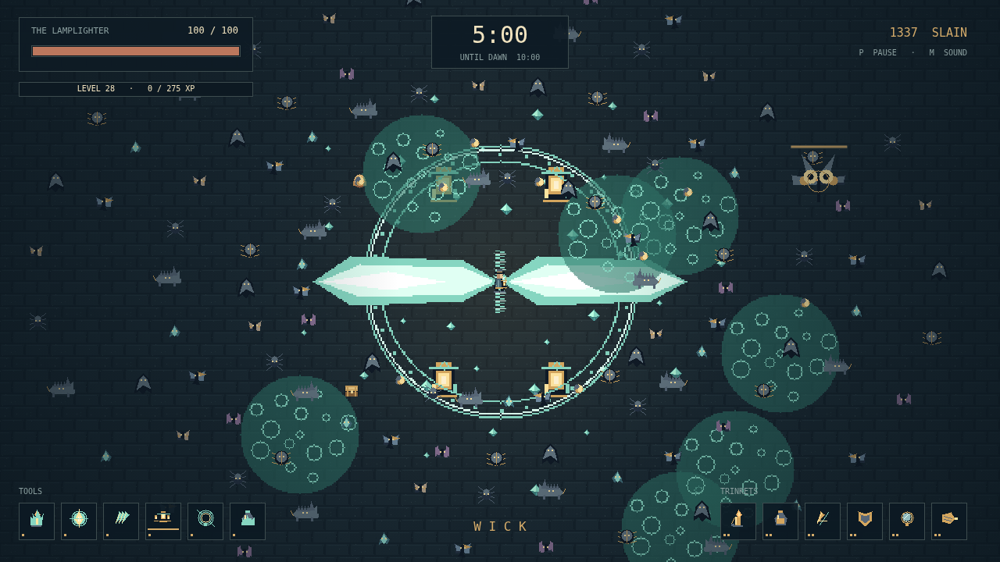

# Wick

One lamplighter. A moth-choked city. Ten minutes until dawn. Carry a small light into an unbounded night, where everything that sees you wants to get closer.

You only walk. Your tools do the fighting, each on its own rhythm: cut a path with Taper, send embers into the crowd, or shelter inside a circle of orbiting lanterns. Position is everything. Leave yourself a way out.

Gather the gems that fallen creatures leave behind. Each level offers a choice of tools and trinkets, across six slots of each kind. Find a combination that keeps the lamp burning. The great creatures carry chests; open one with a mastered tool and its matching trinket to transform your light into something stronger.

Moths give way to bats, crawling armor, and hungry shadows. Swarms cross the streets. The last arrival is the Dark itself. You do not have to conquer the night. You have to keep walking until morning.

